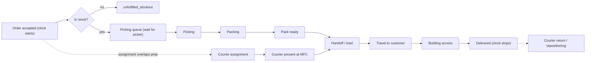

# Phase 2 - Process Map and the Delivery Clock

## The order-to-door process



## Concurrency: assignment does NOT add to preparation

A naive model sums every duration. That is wrong here. **Courier assignment runs
concurrently with picking and packing.** The order is ready to leave only when
**both** the pack is finished **and** a courier is physically present:

```
ready_to_hand_off = max(pack_ready_time, courier_present_time)
```

Two dispatch policies are modelled (compared in Phase 6):
- `assign_at_accept` (baseline): reserve a courier the moment the order is
  accepted. Assignment fully overlaps prep, but a courier may idle-wait for the
  pack, reducing effective fleet capacity.
- `assign_at_ready`: reserve a courier only once the pack is done. No idle
  reservation, but the order may then queue for a courier.

**Courier return / repositioning** travel keeps the courier busy after delivery.
It is excluded from the customer's delivery clock but **included in capacity and
cost**, because a courier returning to the store cannot serve a new order.

## The delivery clock

- **Starts:** when the order is accepted.
- **Stops:** at the doorstep handoff (`delivered`).
- **Does not include:** courier return travel (that is the operator's cost, not
  the customer's wait).

```
order_to_door = delivered_time - accepted_time
             = wait_for_picker + pick_pack
               + max(0, wait_for_courier_presence)
               + load + travel_out + building_access
```

## Order states (every order ends in exactly one)

| State | Definition |
|---|---|
| `completed` | Delivered to the door. Sub-split into **on-time** (`order_to_door <= 15 min`) and **late** (`> 15 min`). |
| `cancelled` | Customer abandoned before a courier began pickup (wait exceeded the patience threshold, `A11`). |
| `unfulfilled_stockout` | Could not be fulfilled because the basket was not fully in stock (`A06`). |
| `unfulfilled_horizon` | Still in the system when the simulation window ended (a backlog the operator never cleared). |

**We never drop failed orders.** Reliability is measured against *all* accepted
orders, so cancellations, stockouts, and backlog all count against the service
level. A model that only looked at completed orders could make a collapsing
service look fast; this one cannot.

## Warm-up and measurement window

Each replication runs for `horizon_min` (default 240). Orders **accepted** before
`warmup_min` (default 30) are excluded from the metrics so start-up transients
(an empty store filling up) don't bias results. Orders still unfinished at the
horizon are counted as `unfulfilled_horizon` so the queue backlog is visible.
