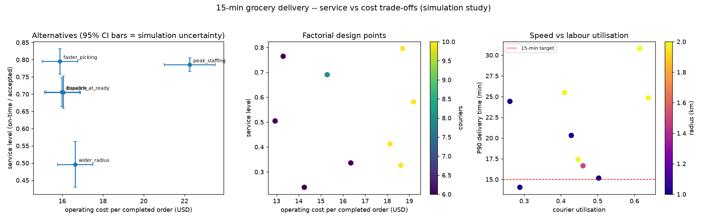

# Phase 7 - Conditional Recommendation and Pilot Plan

## Service-vs-cost dashboard

Rebuild with `python -m gdsim.cli dashboard`. Left: improvement alternatives with
95% CI bars (simulation uncertainty). Middle: factorial design points coloured by
courier count. Right: the speed-vs-labour tension (P90 delivery time vs courier
utilisation) against the 15-min line.

## Conditional recommendation

> **A 15-minute grocery service in a dense, flat, grid-like Bay Area neighbourhood
> (our Phase 1 pick: the SF Mission) *could* be operationally reliable - meeting
> the 15-minute promise at the P90, not just the median - IF, and only if, the
> following conditions hold simultaneously** (all are conditions the model shows
> the result depends on):

1. **Keep the service radius small (~1.0-1.5 km).** Widening to 2 km collapsed
   on-time service from ~70% to ~50% in the model. Coverage trades against speed.
2. **Attack picking as well as delivery.** Faster picking (better slotting/layout)
   was the best-value lever - it met the P90 target at ~no extra cost - because
   capacity added only to couriers eventually just moves the bottleneck to
   picking.
3. **Staff to the peak, not the average**, and accept the cost. Peak staffing met
   the target but raised cost-per-order ~39%; it only pays off if peak demand is
   real and sustained.
4. **Real courier speed must stay near the assumed ~15 km/h effective.** At
   10 km/h (congestion/rain) the target broke in the model. This is a
   neighbourhood-and-weather condition, not a lever to force with unsafe riding.
5. **Baskets must stay small (~6-8 items).** Larger baskets lengthen picking and
   erode service.

**On economics:** even when service is met, viability is a separate question.
Operator-retained revenue per order (~$5.7 contribution in the baseline
assumptions) must cover cost-to-serve (~$16/order operating cost at modelled
volumes). In the model the window does **not** cover its fully-loaded cost at
baseline demand - consistent with the published finding that q-commerce unit
economics lean heavily on **density, high basket value, and advertising/fee
revenue**, not delivery speed alone. So the honest conclusion is:

> **This is an operational-feasibility result, not a profitability claim.** The
> process *can* be made fast under tight conditions; whether it *pays* depends on
> demand density and monetisation assumptions that this study cannot observe and
> only sweeps as sensitivities.

The Blinkit/Zepto-style model is therefore **not obviously impossible** in a dense
US neighbourhood on *operational* grounds - but the binding challenges we can see
are as much **business-model** (density, AOV, ad revenue) as operational.

## What would have to be measured to validate this (real-world pilot plan)

This simulation is **verified, not validated**. A real pilot would need to
measure the following before any of the above could be claimed as fact:

| # | Measure | Why | How |
|---|---|---|---|
| 1 | **Actual order arrivals** by time-of-day, with timestamps | Replace the assumed arrival rate/shape; test the Poisson assumption | Order-management system logs |
| 2 | **Pick + pack times** per order, by basket size | Replace assumed picking model; find the real per-item time | Warehouse scan timestamps |
| 3 | **Courier GPS travel + access times** | Replace geometry-based travel estimate; measure real speed and building-access variation | Courier app telemetry |
| 4 | **Basket composition and stockout/substitution rates** | Replace inventory assumption; quantify unfulfilled orders | Inventory + order data |
| 5 | **Cancellations and the reason** | Validate the patience/abandonment model | App events |
| 6 | **Full delivery-time distribution** (not just mean) | Validate P50/P90/P95 against the model | End-to-end order timestamps |
| 7 | **Fully-loaded cost and retained revenue per order** | Validate cost-to-serve and contribution; separate sales from retained revenue | Finance data |

**Pilot design (staged, like this project):**
1. **Instrument first.** Stand up logging for items 1-7 on an existing operation
   or a single pilot dark store before changing anything.
2. **Baseline period.** Measure 4-8 weeks to characterise demand and variation
   (including weather effects on speed).
3. **Calibrate the model** to the observed inputs and re-run verification.
4. **Confirm the model predicts a holdout period** (train on weeks 1-4, test on
   weeks 5-8) before trusting any forecast.
5. **Run ONE controlled change at a time** (e.g., slotting improvement), measure
   the P90 and cost effect against the baseline, and only then consider the next.
6. **Monitor after rollout** with the service level and P90 as control metrics,
   watching the failure breakdown (late/cancelled/unfulfilled) so reliability is
   never flattered by dropping failed orders.

## Study summary

A verified discrete-event simulation of a 15-minute grocery micro-fulfilment
process for a dense San Francisco neighbourhood, with every input tagged as
observed, published, or assumed. A factorial design on the model identifies
service radius and picker count as the critical parameters; courier count
interacts with both. The 15-minute promise is achievable at the P90 only under a
small radius, adequate picking capacity, and reasonable courier speeds. Viability
then depends on demand density and monetisation, which this study can only sweep
as sensitivities, not observe. Failures count against reliability; contribution
is not profit; high utilisation is not good service; this is a process-design
study, not a claim about any real operator.
